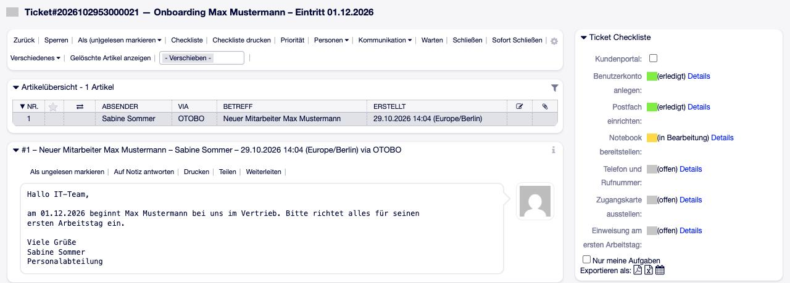
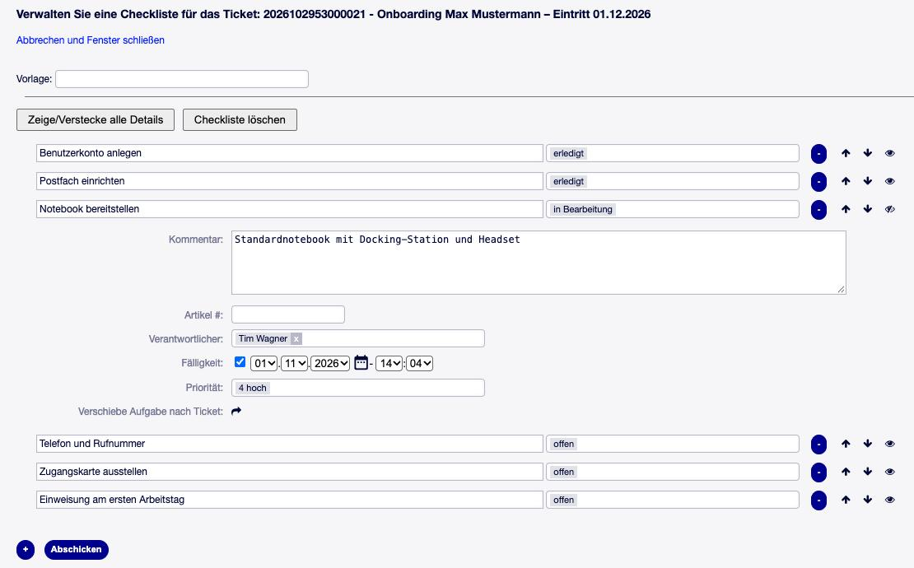
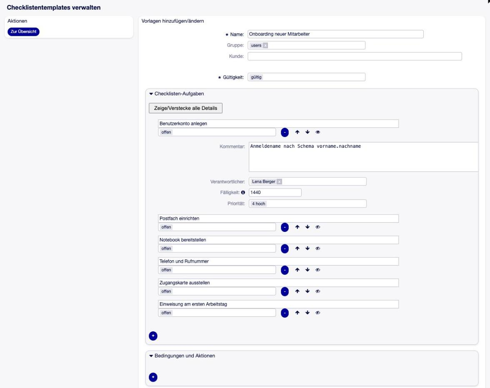
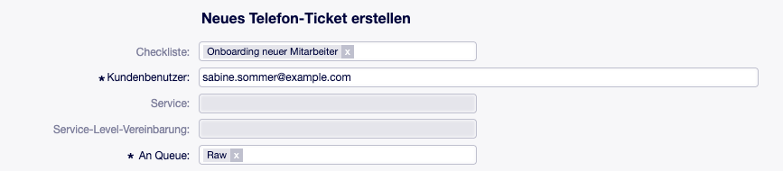
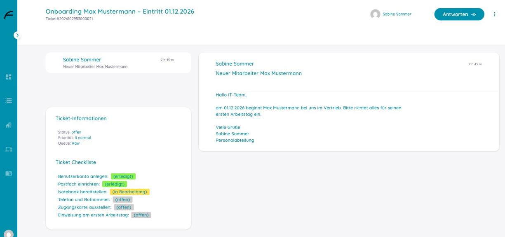

.. Source of this handbook: README.md of this repository, sections overview, flow, configuration,
   example, stored-value, errors, limits, requirements and background, translated into German.
   The README is the one text that is maintained; when one of its sections changes, translate
   the change here. What only customers need — screenshots, click paths — lives only in this file.

.. toctree::
   :maxdepth: 2
   :caption: Inhalt

OTOBO TicketChecklist
=====================

.. admonition:: Open Source
   :class: note

   TicketChecklist steht unter der GNU Affero General Public License v3.0
   (AGPL-3.0). Quelltext, Paket und Lizenztext:
   https://github.com/FreiconOSS/otobo-addon-ticket-checklist — siehe auch
   :ref:`lizenz`.

Beschreibung
============

**TicketChecklist** gibt OTOBO-Tickets eine Checkliste: eine Liste von Aufgaben, jede mit einem
Status und auf Wunsch mit verantwortlichem Agenten, Priorität, Startdatum und Fälligkeit.

Ein typischer Fall: Jedes Onboarding-Ticket braucht dieselben Schritte — Benutzerkonto,
Postfach, Notebook, Zugangskarte, Telefon und so weiter. Eine Administratorin legt sie einmal
als **Checklisten-Vorlage** an. Entsteht das Ticket — durch einen Agenten, per E-Mail, durch
einen Prozess oder den GenericAgent —, kommt die Vorlage auf das Ticket. Die Agenten haken die
Schritte in der Ticketansicht ab, die Verantwortlichen eines Schritts werden benachrichtigt,
wenn er fällig wird, und das Ticket zeigt auf einen Blick, ob noch etwas offen ist.

**Auf einen Blick**

* Aufgabenliste je Ticket mit Status, Verantwortlichem, Priorität, Startdatum und Fälligkeit
* Vorlagen für wiederkehrende Abläufe, auf Gruppen beschränkbar, als JSON exportier- und
  importierbar
* Bedingungen und Aktionen in der Vorlage, z. B. „ist Aufgabe X *erledigt*, wird das Ticket
  *erfolgreich geschlossen*“
* Checkliste kommt per Agent, Ticketmaske, E-Mail-Header, GenericAgent oder Prozess aufs Ticket
* Benachrichtigungen vor der Fälligkeit und zum Startdatum
* Übersichten „Meine Checklisten-Aufgaben“ und „Tickets mit Checkliste“, Dashboard-Widgets,
  Einträge im Ereigniskalender
* Export als PDF, Excel und Kalender-Aufgabe; Ticket-PDF mit Checkliste
* Anzeige der Checkliste im Kundenportal, wenn der Agent sie freigibt
* Ein Paket für OTOBO 11.0 und 11.1, kein Core-Override

TicketChecklist ist die Portierung von **TicketChecklist 10.1.3 von Perl-Services.de** (Renée
Bäcker) auf OTOBO 11. Freicon GmbH & Co. KG pflegt sie unter derselben Lizenz weiter.

Einsatzszenarien
================

**Onboarding und Offboarding.** Ein neuer Mitarbeiter braucht Konto, Postfach, Notebook,
Telefon und Zugangskarte — jedes Mal dieselben Schritte, verteilt auf mehrere Personen. Die
Vorlage bringt alle Schritte samt Verantwortlichen und Fristen aufs Ticket; nichts wird
vergessen, und jeder sieht, was noch fehlt.

**Wiederkehrende Wartung.** Patchday, Zertifikatstausch, Jahresinventur: Eine Checkliste je
Ticket hält fest, welcher Server schon erledigt ist und wer den nächsten übernimmt.

**Arbeitsplatzumzug.** Netzwerkdose, Telefon, Drucker, Möbel — verschiedene Teams, ein
Ticket. Mit Startdatum werden Aufgaben erst zum richtigen Zeitpunkt aktiv und ihre
Verantwortlichen erst dann benachrichtigt.

**Freigaben im Prozess.** Ein Prozess legt per Übergangsaktion die passende Checkliste an;
Bedingungen in der Vorlage setzen den Ticketstatus, sobald die letzte Aufgabe erledigt ist.

.. _ueberblick:

Überblick
---------

* :ref:`user-guide` — Aufgaben abhaken, Checkliste bearbeiten, Übersichten, Drucken
* :ref:`admin-guide` — Vorlagen anlegen, wie die Checkliste aufs Ticket kommt, Kundenportal,
  Benachrichtigungen
* :ref:`beispiel` — Onboarding von der Vorlage bis zur letzten Aufgabe
* :ref:`worauf-achten` — was man wissen sollte
* :ref:`technik` — Voraussetzungen, Installation, alle Einstellungen, Meldungen im Protokoll

.. _user-guide:

Die Checkliste im Alltag
========================

Die Checkliste im Ticket
------------------------

Rechts in der Ticketansicht zeigt das Widget *Ticket Checkliste* die Aufgaben des Tickets mit
ihrem Status in Farbe; **Details** zeigt Verantwortlichen, Fälligkeit und Kommentar. Der
Ticketbesitzer und der Verantwortliche einer Aufgabe ändern den Status direkt dort.

* **Kundenportal** — gibt die Checkliste für den Kunden frei (nur mit
  ``TicketChecklist::Feature::CustomerVisibility``).
* **Nur meine Aufgaben** — blendet die Aufgaben anderer Verantwortlicher aus.
* **Exportieren als** — die Checkliste als PDF, Excel-Datei oder Kalender-Aufgabe.

   Das Onboarding-Ticket mit seiner Checkliste: zwei Aufgaben erledigt, eine in Bearbeitung, drei offen.

Checkliste bearbeiten
---------------------

Der Menüpunkt **Checkliste** im Ticketmenü öffnet die Maske für die ganze Liste:

* **Vorlage** — eine Vorlage wählen und ihre Aufgaben übernehmen (ersetzt die vorhandenen,
  außer ``KeepEntriesOnTemplateChange`` ist an),
* **+** fügt eine Aufgabe hinzu, **–** entfernt sie, die Pfeile sortieren,
* das Augen-Symbol klappt die Details einer Aufgabe auf: Kommentar, Artikel, Verantwortlicher,
  Fälligkeit, Startdatum (mit ``Feature::DateStart``) und Priorität; **Verschiebe Aufgabe
  nach Ticket** hängt sie an ein anderes Ticket,
* **Zeige/Verstecke alle Details** und **Checkliste löschen** wirken auf die ganze Liste.

Gespeichert wird mit **Abschicken**.

   Die Checklisten-Maske: oben die Vorlagenauswahl, darunter die Aufgaben mit ihren Details.

Fälligkeiten und Startdaten erscheinen in der Zeitzone des Agenten.

Übersichten und Dashboard
-------------------------

* **Tickets → Meine Checklisten-Aufgaben** listet alle Aufgaben, für die der Agent
  verantwortlich ist.
* **Tickets → Suche Tickets mit Checkliste** listet Tickets mit offenen Aufgaben.
* Zwei Dashboard-Widgets zeigen dasselbe auf der Startseite; der Ereigniskalender des
  Dashboards zeigt die Fälligkeiten.

Drucken und Export
------------------

**Checkliste drucken** im Ticketmenü erzeugt ein PDF nur der Checkliste. Das Ticket-PDF mit der
Checkliste vor den Artikeln ist der Menüeintrag ``210-PrintChecklist`` — ausgeliefert
abgeschaltet. Ist zusätzlich ``ChecklistSelectArticle`` aktiv, wählt der Agent in der
Artikelliste aus, welche Artikel ins PDF kommen.

.. _admin-guide:

Einrichten: Vorlagen, Wege aufs Ticket, Benachrichtigungen
==========================================================

Checklisten-Vorlagen
--------------------

**Admin → Checklisten-Vorlagen** verwaltet benannte Listen von Aufgaben. Jede Aufgabe einer
Vorlage hat einen Titel und optional:

* **Status** — der Anfangsstatus auf dem Ticket,
* **Verantwortlicher** — ein Agent,
* **Priorität**,
* **Fälligkeit** und **Startdatum** — in Minuten ab dem Zeitpunkt, an dem die Vorlage aufs
  Ticket kommt (1440 = ein Tag),
* **Kommentar** — ein Hinweis zur Aufgabe.

Eine Vorlage lässt sich auf **Gruppen** beschränken: Agenten sehen beim Laden nur die
Vorlagen ihrer Gruppen.

   Die Vorlage *Onboarding neuer Mitarbeiter*: sechs Aufgaben mit Verantwortlichen, Priorität und Fälligkeit in Minuten.

**Bedingungen und Aktionen.** Eine Vorlage kann Regeln mitbringen: Erreicht eine bestimmte
Aufgabe einen bestimmten Status, läuft eine Aktion — etwa „Ticketstatus auf *erfolgreich
geschlossen* setzen“. Die Regeln werden beim Laden der Vorlage ans Ticket übernommen.

**Export und Import.** Vorlagen lassen sich einzeln oder alle zusammen als JSON exportieren
und auf einem anderen System importieren. Gibt es dort schon eine Vorlage gleichen Namens,
wird sie ersetzt (``TicketChecklist::OverrideExistingTemplatesOnImport``). Verweist eine
importierte Vorlage auf einen Agenten, eine Queue, einen Status oder eine Priorität, die es
nicht gibt, bleibt dieser Wert leer, und das Protokoll vermerkt es.

.. _wege:

Wie die Checkliste aufs Ticket kommt
------------------------------------

**Agent.** Im Ticketmenü *Checkliste* Aufgaben von Hand anlegen oder eine Vorlage laden.

**Ticket anlegen.** Mit ``TicketChecklist::ShowChecklistInTicketCreate`` zeigen die Masken
*Neues Telefon-Ticket* und *Neues E-Mail-Ticket* ganz oben das Feld *Checkliste*. Rechts
erscheint eine Vorschau der Aufgaben, die sich vor dem Anlegen noch bearbeiten lässt; wer den
Kunden erst danach auswählt, behält die gewählte Vorlage.

   Neues Telefon-Ticket mit der Vorlage *Onboarding neuer Mitarbeiter*.

**E-Mail.** Ein neues Ticket bekommt die Vorlage über den Header
``X-OTRS-TicketChecklistID: <Vorlagen-ID>`` oder ``X-OTRS-TicketChecklistName: <Vorlagenname>``;
eine Folge-E-Mail über ``X-OTRS-FollowUp-TicketChecklistID`` bzw. ``-Name``.

**E-Mail, Aufgaben ändern.** ``X-OTRS-TicketChecklistItem-<n>: <Titel der Aufgabe>`` plus
``X-OTRS-TicketChecklistItem-<n>-Status``, ``-StatusID``, ``-DueDate``, ``-ResponsibleID``,
``-PriorityID`` (n = 1 … 20) ändert die Aufgabe dieses Titels am Ticket, zu dem die E-Mail gehört.

**GenericAgent.** Modul ``Kernel::System::GenericAgent::AddChecklistToTicket`` mit dem
Parameter ``TemplateID`` bringt eine Vorlage aufs Ticket. Modul
``Kernel::System::GenericAgent::ChangeChecklistItems`` ändert Aufgaben: ``Item_1`` (Titel der
Aufgabe) mit ``Status_1``, ``DueDate_1``, ``Responsible_1`` (Login), ``Priority_1`` (Name);
``Item_2`` … ebenso.

**Prozess.** Übergangsaktion ``AddChecklist`` (Konfiguration ``TemplateID``) und
``ChangeChecklistItems`` (dieselben ``Item_<n>``-Schlüssel wie beim GenericAgent).

Die E-Mail-Header behalten das Präfix ``X-OTRS-`` des Originals; bestehende Postmaster-Filter
und sendende Systeme arbeiten unverändert weiter.

Kundenportal
------------

Mit ``TicketChecklist::Feature::CustomerVisibility`` kann ein Agent die Checkliste eines
Tickets für den Kunden freigeben. Der Kunde sieht dann in seiner Ticketansicht die Aufgaben und
ihren Status — bearbeiten kann er sie nicht. Mit ``Queues::CustomerVisibility`` ist die
Checkliste in ausgewählten Queues von vornherein sichtbar.

   Dasselbe Onboarding-Ticket im Kundenportal: Die Personalabteilung sieht, welche Schritte
   erledigt sind.

Checklisten-Status
------------------

**Admin → Checklisten-Status** verwaltet die Status der Aufgaben samt Farbe. Installiert sind
*offen*, *erledigt*, *abgelehnt*, *warten* und *in Bearbeitung*. Ein Status, den eine Aufgabe
noch verwendet, lässt sich nicht löschen.

Welche Status als „offen“, „wartend“ oder „versteckt“ zählen, legen ``OpenStates``,
``WaitingStates`` und ``HiddenStates`` fest (siehe :ref:`Konfiguration`).

Checklisten-Benachrichtigungen
------------------------------

**Admin → Checklistenbenachrichtigungen** verwaltet die Texte, die verschickt werden, wenn eine
Aufgabe fällig wird, ihr Startdatum erreicht oder geändert wird — je Ereignis und Sprache.
Installiert sind deutsche Texte für *Verantwortlicher geändert*, *Status geändert* und *Fälligkeit
naht*. Gibt es für ein Ereignis keinen Text in der Sprache des Agenten, wird nichts
verschickt.

Agenten schalten die Benachrichtigungen in ihren persönlichen Einstellungen ein und aus
(Gruppe *Checklisten-Benachrichtigungen*).

.. _beispiel:

Beispiel: Onboarding
====================

#. **Admin → Checklisten-Vorlagen → Vorlage hinzufügen**: Name *Onboarding neuer
   Mitarbeiter*, Aufgaben *Benutzerkonto anlegen* (Verantwortlich: IT, Fälligkeit 1440 =
   ein Tag), *Notebook bereitstellen* (Fälligkeit 4320 = drei Tage), *Zugangskarte ausstellen*
   (Startdatum 7200 = fünf Tage, Fälligkeit 10080 = sieben Tage). Gruppe: *users*.
#. ``TicketChecklist::ShowChecklistInTicketCreate`` einschalten und, für das Startdatum,
   ``TicketChecklist::Feature::DateStart``.
#. Ein Telefon-Ticket anlegen und im Feld für die Checkliste *Onboarding neuer Mitarbeiter*
   wählen. Die Ticketansicht zeigt die drei Aufgaben; *Zugangskarte ausstellen* steht auf
   *warten*.
#. Die IT bekommt eine Stunde vor der Fälligkeit von *Benutzerkonto anlegen* eine
   Benachrichtigung (``TicketChecklist::DueDateBefore``) und setzt die Aufgabe im Widget auf
   *erledigt*.
#. Fünf Tage später stellt der Daemon *Zugangskarte ausstellen* auf *offen* und benachrichtigt
   den Verantwortlichen.
#. *Tickets → Suche Tickets mit Checkliste* führt das Ticket, bis alle Aufgaben erledigt sind;
   das dynamische Feld ``TicketHasOpenTodos`` steht für Suchen, ACLs und den GenericAgent
   bereit.

Dieselbe Vorlage kann auch per E-Mail kommen (``X-OTRS-TicketChecklistName: Onboarding neuer
Mitarbeiter``) oder aus einem Prozess (Übergangsaktion ``AddChecklist`` mit der ID der Vorlage).

.. _worauf-achten:

Worauf achten
=============

* **Der Titel ist der Schlüssel.** E-Mail-Header, GenericAgent und Prozess finden eine
  Aufgabe über ihren Titel. Stehen zwei Aufgaben gleichen Titels auf einem Ticket, wird nur
  die erste geändert.
* **Höchstens 20 Aufgaben je E-Mail** lassen sich mit ``X-OTRS-TicketChecklistItem-<n>``
  ändern.
* **Die E-Mail-Header** behalten das Präfix ``X-OTRS-`` des Originals.
* **Kunden sehen, bearbeiten aber nicht.** Im Kundenportal ist die Checkliste nur eine Anzeige.
* **Ohne Daemon keine Benachrichtigungen** und keine Startdaten.
* **Alles drin.** Prioritäten, Verantwortliche, Fälligkeiten, Benachrichtigungen, Übersichten,
  Sortierung und Vorlagen — beim Original als *Pro*-Funktionen verkauft — gehören zu diesem
  Paket.

.. _technik:

Technische Referenz
===================

Dieser Teil richtet sich an Administratoren: Voraussetzungen, Installation, wie das Addon
intern arbeitet, alle Einstellungen der Systemkonfiguration, Meldungen im Protokoll und die
gespeicherten Daten.

Systemvoraussetzungen
---------------------

Framework
~~~~~~~~~
OTOBO 11.0.x oder 11.1.x — ein Paket für beide Versionen.

Pakete
~~~~~~
Keine.

Software von Drittanbietern
~~~~~~~~~~~~~~~~~~~~~~~~~~~
Das Perl-Modul ``Net::LDAP`` — nur, wenn Verantwortliche aus einem LDAP-Verzeichnis gewählt
werden sollen (ein optionales Modul von OTOBO, siehe ``bin/otobo.CheckModules.pl``).

.. _Installation:

Installation
------------

Das Paket wird wie jedes OTOBO-Paket über **Admin → Paketverwaltung** installiert. Es legt
seine Tabellen, die Status *offen*, *erledigt*, *abgelehnt*, *warten* und *in Bearbeitung*,
deutsche Benachrichtigungstexte und vier interne dynamische Felder an (siehe
:ref:`daten`). Die E-Mail-Header für Checklisten trägt es in ``PostmasterX-Header`` ein.

Damit Benachrichtigungen und Startdaten wirken, muss der OTOBO-Daemon laufen.

Umstieg von Version 10.1.3
~~~~~~~~~~~~~~~~~~~~~~~~~~

Das Paket wird über die alte Version installiert. Das Upgrade holt die Dateien aus
``Custom/``, stellt den Gruppenschlüssel der Vorlagen auf die OTOBO-11-Tabelle um und entfernt
die alte Einstellung ``Ticket::CustomModule###10001-TicketChecklist``. Vorlagen, Aufgaben und
Status bleiben erhalten. Die Beispieldatei ``Kernel/Config/Files/ZZZChecklist.pm`` der alten
Version entfällt.

Wie das Addon arbeitet
----------------------

Die Aufgaben einer Checkliste gehören zu genau einem Ticket. Jede Änderung — neue Aufgabe,
neuer Status, neuer Verantwortlicher, neue Fälligkeit — löst ein Checklisten-Ereignis aus. Daran
hängen Tickethistorie, Änderungsnotiz, Benachrichtigungen, die dynamischen Felder und die
Bedingungen der Vorlage.

Der Daemon prüft alle zehn Minuten die Fälligkeiten und Startdaten: Er benachrichtigt den
Besitzer bzw. Verantwortlichen einer Aufgabe, deren Fälligkeit naht, und stellt Aufgaben, deren
Startdatum erreicht ist, von *warten* auf *offen*.

Die Checkliste erscheint als Widget rechts in der Ticketansicht, in zwei Dashboard-Widgets, in
den Übersichten *Meine Checklisten-Aufgaben* und *Suche Tickets mit Checkliste*, im
Ereigniskalender, im PDF — und im Kundenportal, wenn sie dort freigegeben ist.

.. _Konfiguration:

Konfiguration
-------------

Alle Einstellungen stehen in der Systemkonfiguration unter **Core → TicketChecklist** und
ihren Untergruppen. Angegeben sind die ausgelieferten Standardwerte.

Allgemein — Core → TicketChecklist
~~~~~~~~~~~~~~~~~~~~~~~~~~~~~~~~~~

``TicketChecklist::DefaultState`` — Standard: *open*
   Status einer neuen Aufgabe.

``TicketChecklist::DefaultPriority`` — Standard: *3 normal*
   Priorität einer neuen Aufgabe (es gelten die Ticketprioritäten). Auch der Rückfallwert,
   wenn eine Aufgabe ohne Priorität gespeichert wird.

``TicketChecklist::PrioritySource`` — Standard: *DefaultPriority*
   Woher die Priorität einer neuen Aufgabe kommt: aus der Einstellung oben oder aus der
   Priorität des Tickets.

``TicketChecklist::OpenStates`` — Standard: *open*
   Status, die als „offen“ zählen (Übersichten, dynamisches Feld ``TicketHasOpenTodos``).

``TicketChecklist::WaitingStates`` — Standard: *waiting*
   Status von Aufgaben, die auf ihr Startdatum warten.

``TicketChecklist::HiddenStates`` — Standard: leer, deaktiviert
   Aufgaben in diesen Status erscheinen nicht im Widget der Ticketansicht.

``TicketChecklist::ClosedState`` — Standard: *done*
   Status, den die Aufgaben bekommen, wenn das Ticket geschlossen wird (Ereignis
   ``1032-CloseChecklistItems``, standardmäßig aus).

``TicketChecklist::Theme`` — Standard: *Standard*
   Aussehen der Checklisten-Maske: *Standard* oder *Slim*.

``TicketChecklist::DetailsInWidget`` — Standard: *Link*
   Wie das Widget die Details einer Aufgabe zeigt: als Link, beim Überfahren mit der Maus oder
   gar nicht.

``TicketChecklist::Widget::ShowResponsibleFullname`` — Standard: aus
   Zeigt im Widget den vollen Namen des Verantwortlichen statt des Logins.

``TicketChecklist::ReloadChecklist`` — Standard: aus
   Lädt das Widget neu, nachdem eine Aufgabe geändert wurde.

``TicketChecklist::ReloadTicketZoom`` — Standard: aus
   Lädt die ganze Ticketansicht neu, nachdem eine Aufgabe geändert wurde.

``TicketChecklist::AllUsersForResponsibles`` — Standard: an
   Alle Agenten sind als Verantwortliche wählbar. Aus: nur Agenten mit Leserecht (``ro``) auf
   die Queue des Tickets.

``TicketChecklist::AllAgentsStatusChange`` — Standard: aus
   Jeder Agent darf den Status jeder Aufgabe ändern. Aus: nur der Ticketbesitzer und der
   Verantwortliche der Aufgabe.

``TicketChecklist::RWGroups`` — Standard: leer, deaktiviert
   Nur Mitglieder dieser Gruppen (mit ``rw``) dürfen die Checkliste bearbeiten.

``TicketChecklist::HardDeleteItems`` — Standard: an
   An: Eine in der Maske entfernte Aufgabe wird sofort gelöscht. Aus: erst beim Speichern der
   Checkliste.

``TicketChecklist::ConfirmDeleteItems`` — Standard: aus
   Fragt nach, bevor eine Aufgabe entfernt wird.

``TicketChecklist::KeepEntriesOnTemplateChange`` — Standard: aus
   Beim Laden einer Vorlage werden ihre Aufgaben ergänzt, statt die vorhandenen zu ersetzen.

``TicketChecklist::ShowChecklistInTicketCreate`` — Standard: aus
   Vorlagenauswahl in den Masken *Neues Telefon-Ticket* und *Neues E-Mail-Ticket*.

``TicketChecklist::AllowMultiChecklistsInTicketCreate`` — Standard: aus
   Zeigt neben dieser Auswahl „Fügt Punkte zur bestehenden Checkliste hinzu“.

``TicketChecklist::OverrideExistingTemplatesOnImport`` — Standard: an
   Ein Vorlagen-Import ersetzt Vorlagen mit gleichem Namen.

``TicketChecklist::ShowExportIcons`` — Standard: Ticketansicht an, Dashboard (Meine Aufgaben) aus
   Wo die Symbole für PDF, Excel und Kalender-Aufgabe erscheinen.

``TicketChecklist::PrintItemComment`` — Standard: aus
   Druckt den Kommentar einer Aufgabe im Ticket-PDF mit.

``TicketChecklist::PastDueDatesAllowed`` — Standard: an
   Aus: Eine Fälligkeit in der Vergangenheit wird abgelehnt.

``TicketChecklist::DueDateYearsInPast`` — Standard: 0
   Wie viele Jahre zurück die Datumsauswahl anbietet.

``TicketChecklist::DynamicFieldHasOpenTodos`` — Standard: *TicketHasOpenTodos*
   Dynamisches Feld, das festhält, ob das Ticket offene Aufgaben hat.

``TicketChecklist::Condition::MultiState`` — Standard: aus
   Eine Bedingung in der Vorlage darf mehrere Status nennen (oder-verknüpft).

``TicketChecklist::AllowTicketsAsItems`` — Standard: aus
   Als Titel einer Aufgabe darf eine Ticketnummer stehen; die Aufgabe folgt dann diesem Ticket.

``TicketChecklist::LinkTickets`` — Standard: aus
   Zusammen mit der Option oben: das genannte Ticket als Kind mit diesem verknüpfen.

``TicketChecklist::TicketStateToItemState`` — Standard: neu/offen/warten → *open*, zusammengefasst/erfolgreich geschlossen → *done*, …
   Ticketstatus → Aufgabenstatus, für Tickets als Aufgaben.

``TicketChecklist::ItemStateToTicketState`` — Standard: *open* → offen, *done* → erfolgreich geschlossen, *rejected* → erfolglos geschlossen
   Aufgabenstatus → Ticketstatus, für Tickets als Aufgaben.

``TicketChecklist::Debug`` — Standard: aus
   Debug-Ausgaben ins OTOBO-Protokoll.

``Ticket::Frontend::HistoryTypes###212-Checklist``
   Zeigt die Checklisten-Einträge in der Tickethistorie.

Funktionen — Core → TicketChecklist → Features
~~~~~~~~~~~~~~~~~~~~~~~~~~~~~~~~~~~~~~~~~~~~~~

``TicketChecklist::Feature::DateStart`` — Standard: aus
   Aufgaben bekommen ein Startdatum. Bis dahin stehen sie auf *warten*; der Daemon öffnet sie.

``TicketChecklist::Feature::CustomerVisibility`` — Standard: aus
   Agenten können die Checkliste eines Tickets im Kundenportal anzeigen.

``TicketChecklist::Feature::FromTextarea`` — Standard: aus
   Aufgaben lassen sich als Zeilen eines Textfelds eingeben.

``Queues::CustomerVisibility`` (Untergruppe *CustomerVisibility*) — Standard: deaktiviert, Beispiel *Misc* → 1
   Queues, in denen die Checkliste standardmäßig für den Kunden sichtbar ist.

Benachrichtigungen — Core → TicketChecklist → Notifications
~~~~~~~~~~~~~~~~~~~~~~~~~~~~~~~~~~~~~~~~~~~~~~~~~~~~~~~~~~~

``TicketChecklist::DueDateBefore`` — Standard: 60
   Minuten vor der Fälligkeit, zu denen benachrichtigt wird.

``TicketChecklist::NotificationTimes`` — Standard: deaktiviert, Beispiel *-60m*, *-5d*
   Mehrere Zeitpunkte vor der Fälligkeit statt des einen oben.

``TicketChecklist::NotificationTimesSpan`` — Standard: 10
   Minuten, die um jeden dieser Zeitpunkte geprüft werden — sollte dem Daemon-Intervall
   entsprechen.

``TicketChecklist::DateStartBefore`` — Standard: 60
   Minuten vor dem Startdatum, zu denen benachrichtigt wird.

``TicketChecklist::StartNotificationTimes`` — Standard: deaktiviert, Beispiel *-60m*, *-5d*
   Wie ``NotificationTimes``, für das Startdatum.

``TicketChecklist::StartNotificationTimesSpan`` — Standard: 10
   Wie ``NotificationTimesSpan``, für das Startdatum.

``TicketChecklist::NotificationQueueExclude`` — Standard: deaktiviert, Beispiel *Junk*
   Keine Checklisten-Benachrichtigungen für Tickets in diesen Queues.

``PreferencesGroups###ChecklistNotifications`` — Standard: aktiv
   Die persönliche Einstellung, mit der Agenten die Benachrichtigungen ein- und ausschalten.

Startdatum — Core → TicketChecklist → StartDate
~~~~~~~~~~~~~~~~~~~~~~~~~~~~~~~~~~~~~~~~~~~~~~~

``TicketChecklist::StartDate::NewState`` — Standard: *open*
   Status, den eine Aufgabe bekommt, wenn ihr Startdatum erreicht ist.

Änderungsnotizen — Core → TicketChecklist → ChangeNote
~~~~~~~~~~~~~~~~~~~~~~~~~~~~~~~~~~~~~~~~~~~~~~~~~~~~~~

``TicketChecklist::ShowChangeNotes`` — Standard: aus
   Agenten können eine Notiz erfassen, wenn sie eine Aufgabe in der Maske ändern.

``TicketChecklist::ShowChangeNotesWidget`` — Standard: aus
   Dasselbe, wenn der Status im Widget geändert wird.

``TicketChecklist::ChangeNoteAsArticle`` — Standard: aus
   Die Notiz wird ein Artikel am Ticket.

``TicketChecklist::ChangeNoteArticle###Type`` — Standard: *note-internal*
   Artikeltyp dieses Artikels.

``TicketChecklist::ChangeNoteArticle###Subject`` — Standard: *TODO changed*
   Betreff dieses Artikels.

``TicketChecklist::ChangeNoteAsNotification`` — Standard: an
   Die Notiz ist Teil der Änderungsbenachrichtigung.

``TicketChecklist::SaveChangeNote`` — Standard: aus
   Die Notiz wird an der Aufgabe gespeichert.

``TicketChecklist::EditChangeNote`` — Standard: aus
   Eine gespeicherte Notiz lässt sich bearbeiten.

``TicketChecklist::ChangeNoteDialogRows`` / ``…Cols`` — Standard: 10 / 40
   Größe des Notizfelds.

``TicketChecklist::ChangeNote::ASCII2HTML`` — Standard: aus
   Zeigt die Notiz mit Zeilenumbrüchen und maskiertem HTML.

``TicketChecklist::ChangeNote::URLAutolink`` — Standard: aus
   Macht Adressen in der Notiz zu Links (braucht die Option oben).

Kommentare — Core → TicketChecklist → Comment
~~~~~~~~~~~~~~~~~~~~~~~~~~~~~~~~~~~~~~~~~~~~~

``TicketChecklist::Comment::ASCII2HTML`` — Standard: aus
   Zeigt den Kommentar einer Aufgabe mit Zeilenumbrüchen und maskiertem HTML.

``TicketChecklist::Comment::URLAutolink`` — Standard: aus
   Macht Adressen im Kommentar zu Links (braucht die Option oben).

Verantwortliche — Core → TicketChecklist → Responsible
~~~~~~~~~~~~~~~~~~~~~~~~~~~~~~~~~~~~~~~~~~~~~~~~~~~~~~

``TicketChecklist::ResponsibleAutocomplete`` — Standard: aus
   Ersetzt die Auswahlliste der Verantwortlichen durch ein Suchfeld mit Vorschlägen.

``TicketChecklist::ResponsibleAutocompleteModule`` — Standard: *Agent*
   Quelle dieses Suchfelds: *Agent*, *LDAP*, *Groups* oder *Roles*.

Die Quelle *LDAP* liest ihre Verbindung aus dem Hash ``TicketChecklist::ResponsibleLDAP``.
Er ist **keine** Einstellung der Systemkonfiguration und hat keinen Standardwert; er gehört in
``Kernel/Config.pm``, im selben Aufbau wie ein LDAP-Backend für Kundenbenutzer:

.. code-block:: perl

   $Self->{'TicketChecklist::ResponsibleLDAP'} = {
       Params => {
           Host   => 'ldap.example.com',
           BaseDN => 'ou=people,dc=example,dc=com',
           SSCOPE => 'sub',
           UserDN => '',            # leer = anonymer Bind
           UserPw => '',
           AlwaysFilter => '',      # z. B. '(objectclass=user)'
           Die    => 0,
           Params => { port => 389, timeout => 120, async => 0, version => 3 },
       },
       UserKey             => 'uid',
       UserListFields      => [ 'cn', 'mail' ],
       UserSearchFields    => [ 'uid', 'cn', 'mail' ],
       UserSearchPrefix    => '',
       UserSearchSuffix    => '*',
       UserSearchListLimit => 250,
       UserNameFields      => [ 'givenname', 'sn' ],
       CacheTTL            => 0,
       Map => [ ... ],          # wie in einem LDAP-Backend für Kundenbenutzer
   };

Kalender — Core → TicketChecklist → Calendar
~~~~~~~~~~~~~~~~~~~~~~~~~~~~~~~~~~~~~~~~~~~~

``TicketChecklist::Calendar::Color`` — Standard: *#cdcdcd*
   Farbe der Checklisten-Einträge im Ereigniskalender des Dashboards.

``TicketChecklist::Calendar::TitleFormat`` — Standard: ``#[% Data.TicketNumber %] - [% Data.Title %]``
   Titel eines Eintrags.

``TicketChecklist::Calendar::InfoFormat`` — Standard: ``[% Data.TicketNumber %] - [% Data.Title %]``
   Text beim Überfahren eines Eintrags mit der Maus.

Ereignisse — Core → Event
~~~~~~~~~~~~~~~~~~~~~~~~~

Ticket-Ereignisse (``Ticket::EventModulePost###…``):

``1031-MergeTicketChecklists`` — an
   Verschiebt die Aufgaben eines zusammengefassten Tickets ins Zielticket.

``1032-CloseChecklistItems`` — **aus**
   Setzt alle Aufgaben auf ``TicketChecklist::ClosedState``, wenn das Ticket geschlossen wird.

``1033-UpdateChecklistItems`` — an
   Hält Aufgaben, die für ein Ticket stehen, mit diesem Ticket gleich.

``1037-SetTicketChecklists`` — an
   Bringt die in der Ticketmaske gewählte Vorlage auf das neue Ticket.

Checklisten-Ereignisse (``TicketChecklist::EventModule###…``), alle an: ``001-Notifications``,
``002-TicketHistory``, ``003-ChangeNote``, ``004-SetHasOpenTodos``, ``005-ConditionAction``
(Bedingungen und Aktionen der Vorlage), ``006-SetHasChecklist``,
``007-SetDefaultCustomerVisibility``, ``011-SetTicketState``, ``012-ForeignTickets``,
``020-RemoveTicketInfoFlags``.

Daemon — Daemon → SchedulerCronTaskManager → Task
~~~~~~~~~~~~~~~~~~~~~~~~~~~~~~~~~~~~~~~~~~~~~~~~~

``ChecklistNotifications`` — alle 10 Minuten
   ``Maint::Ticket::ChecklistNotifications``: Benachrichtigungen zur Fälligkeit.

``ChecklistStartDateNotifications`` — alle 10 Minuten
   ``Maint::Ticket::ChecklistStartDateNotifications``: Benachrichtigungen zum Startdatum.

``ChecklistSetStartDateStatus`` — alle 10 Minuten
   ``Maint::Ticket::ChecklistSetStartDateStatus``: *warten* → ``StartDate::NewState``.

``ChecklistClearPreferences`` — sonntags, zwischen 0 und 1 Uhr alle 10 Minuten
   ``Maint::Ticket::ChecklistClearPreferences``: setzt zurück, für welche Tickets ein Agent
   sich alle Aufgaben anzeigen lässt.

Registrierung
~~~~~~~~~~~~~

Diese Einstellungen melden die Teile des Addons in OTOBO an. Sie werden nur geändert, um einen
Menüeintrag oder ein Widget zu verschieben oder abzuschalten.

``Frontend::Module###AgentTicketChecklist`` und die übrigen Agentenmodule
   Checklisten-Maske, Vorlagen laden, Statuswechsel, Verantwortlichen-Suche, Kundenportal-Schalter,
   Kalender, Druck, Export, Übersichten — alle an.

``Frontend::Module###AdminTicketChecklistStates``, ``…Templates``, ``…Notifications``
   Die drei Admin-Masken und ihre Kacheln in der Admin-Übersicht — an.

``Frontend::Navigation###AgentChecklistTickets###002-TicketChecklist``, ``###AgentChecklistMyTodo###002-TicketChecklist``
   Hauptmenü *Tickets → Suche Tickets mit Checkliste* und *Meine Checklisten-Aufgaben* — an.
   Alle anderen ``Frontend::Navigation###…###002-TicketChecklist``-Einträge sind ausgeliefert
   deaktiviert.

``Ticket::Frontend::MenuModule###212-Checklist``, ``###213-ChecklistPrint``
   Ticketmenü *Checkliste* und *Checkliste drucken* — an.

``Ticket::Frontend::MenuModule###210-PrintChecklist``
   Ticketmenü *Drucken*: Ticket-PDF mit der Checkliste vor den Artikeln — aus.

``Ticket::Frontend::AgentTicketZoom###Widgets###002-TicketChecklist``
   Widget in der Ticketansicht — an.

``DashboardBackend###0991-ChecklistItems``, ``###0992-ChecklistTicket``
   Dashboard-Widgets — an.

``Frontend::Output::FilterElementPost###OutputFilterTicketChecklistDropdown``
   Vorlagenauswahl in den Ticketmasken — an.

``Frontend::Output::FilterElementPost###TicketChecklistCalendar``
   Aufgaben im Ereigniskalender des Dashboards — an.

``Frontend::Output::FilterElementPost###CustomerTicketChecklist``
   Checkliste in der Ticketansicht des Kundenportals — an.

``Frontend::Output::FilterElementPost###ChecklistSelectArticle``
   Auswahlkästchen in der Artikelliste, um die Artikel fürs Ticket-PDF zu wählen — aus.

``Frontend::Template::GenerateBlockHooks###132-TicketChecklist``
   Block-Hooks, die die Ausgabefilter brauchen — an.

``Loader::Module::…###00x-TicketChecklist``, ``Loader::Agent::CommonCSS###100001-TicketChecklist``, ``Loader::Customer::CommonCSS###100001-TicketChecklist``
   JavaScript und CSS — an.

``PostMaster::PostFilterModule###015-TicketChecklist``, ``###016-TicketChecklistItem``
   Die E-Mail-Header aus :ref:`wege` — an.

``Stats::DynamicObjectRegistration###TicketChecklistStatusFilter``
   Ticketstatistik mit Filter auf den Aufgabenstatus — an.

``AutoloadPerlPackages###2000-TicketChecklist``
   Entfernt die Checkliste, wenn ein Ticket gelöscht wird — an.

Meldungen im Protokoll
----------------------

``Need TicketChecklist::ResponsibleLDAP->Params->Host in Kernel/Config.pm`` (ebenso ``BaseDN``, ``SSCOPE``, ``UserKey``)
   Als Quelle der Verantwortlichen ist *LDAP* gewählt, der Hash
   ``TicketChecklist::ResponsibleLDAP`` fehlt aber oder ist unvollständig.

``Can't connect to <host>: …`` / ``First bind failed! …`` / ``Search failed! …``
   LDAP-Server nicht erreichbar, falscher Bind-Benutzer oder falsche Base-DN.

``Need UserID!``
   Ein GenericAgent-Job oder eine Übergangsaktion ist ohne diesen Parameter eingerichtet.

``Need TemplateID!``
   GenericAgent-Modul oder Übergangsaktion ``AddChecklist`` ohne ``TemplateID``.

``Templatename already exists``
   Eine Vorlage wurde unter einem vergebenen Namen gespeichert. Beim Import siehe
   ``OverrideExistingTemplatesOnImport``.

``Import: Can' find user/queue/state/priority …``
   Die importierte Vorlage nennt etwas, das es auf diesem System nicht gibt; der Wert bleibt leer.

``Could not find notification for <event> (<language>)`` (nur im Debug-Protokoll)
   Für dieses Ereignis gibt es keinen Benachrichtigungstext in der Sprache des Agenten, also
   wird keine verschickt. Soll eine verschickt werden: Text unter **Admin →
   Checklistenbenachrichtigungen** anlegen.

``State name alread in use``
   Einen Status dieses Namens gibt es schon.

**Gar keine Benachrichtigungen?** Prüfen, ob der Daemon läuft (``bin/otobo.Daemon.pl
status``), ob der Agent sie in seinen Einstellungen abgeschaltet hat und ob die Queue des
Tickets in ``TicketChecklist::NotificationQueueExclude`` steht.

.. _daten:

Gespeicherte Daten
------------------

``ps_ticketchecklist``
   Die Aufgaben: Ticket, Titel, Position, Status, Priorität, Verantwortlicher, Start und
   Fälligkeit, Kommentar, Änderungsnotiz.

``ps_ticketchecklist_status``
   Status und Farben.

``ps_checklist_template``, ``ps_checklist_tmpl_grp``
   Vorlagen und ihre Gruppen.

``ps_checklist_notify``
   Benachrichtigungstexte je Ereignis und Sprache.

``ps_checklist_ticket_info``
   Je Ticket: ob die Checkliste im Kundenportal sichtbar ist.

Bei der Installation entstehen vier interne dynamische Felder am Ticket:
``TicketHasOpenTodos``, ``TicketHasChecklist``, ``TicketChecklistTemplates`` (die verwendeten
Vorlagen) und ``TicketChecklistConditionActions`` (die aus den Vorlagen übernommenen
Bedingungen und Aktionen). Die ersten beiden eignen sich für Suchen, ACLs und den GenericAgent.

Zeiten werden in OTOBO-Zeit gespeichert (``OTOBOTimeZone``) und in der Zeitzone des Agenten
angezeigt.

.. _lizenz:

Lizenz und Herkunft
===================

TicketChecklist wurde von Renée Bäcker (Perl-Services.de) geschrieben und unter der GNU Affero
General Public License v3.0 veröffentlicht. Das Repository beginnt mit der unveränderten
Version 10.1.3; darauf folgen die Änderungen für OTOBO 11 durch Freicon GmbH & Co. KG
(Oktober 2026): Zeitverarbeitung auf ``Kernel::System::DateTime``, die umbenannte
Gruppentabelle, das Ticket-PDF auf dem PDF-Backend von OTOBO 11, ein Autoload statt
``Ticket::CustomModule``, Dateien aus ``Custom/`` heraus, die Navigation der
Systemkonfiguration, keine LDAP-Beispielkonfiguration mehr, und einige Fehler, die dabei
auffielen. Jede geänderte Datei trägt einen Änderungsvermerk mit Datum.

Das ganze Werk bleibt unter AGPL-3.0. Der Lizenztext liegt im Repository und wird im Paket als
``var/doc/TicketChecklist/COPYING`` mitgeliefert. Wer eine veränderte Fassung Benutzern über ein
Netzwerk anbietet, muss ihnen nach §13 der AGPL den Quelltext dieser Fassung zugänglich machen.

Mitwirkende am Original: Denny Bresch (Übersetzungen, HTML), Balázs Úr (ungarische Übersetzung).

| **Quelltext:** https://github.com/FreiconOSS/otobo-addon-ticket-checklist
| **Lizenz:** GNU Affero General Public License v3.0

Über
====

| **Pflege:** Freicon GmbH & Co.KG
| **Web:** https://freicon.de
| **Kontakt:** Bei Fragen zu Einrichtung, Schulung und Betrieb unterstützt Sie das Freicon-Consulting-Team.
